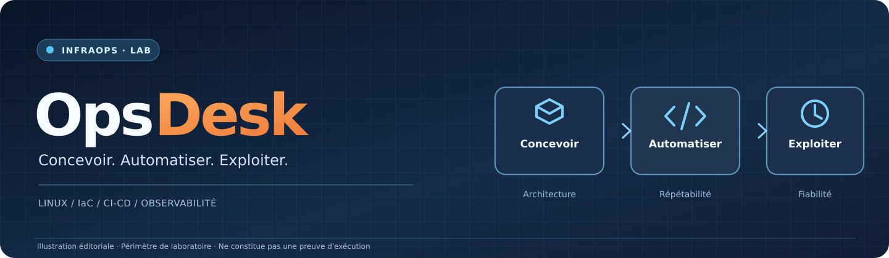
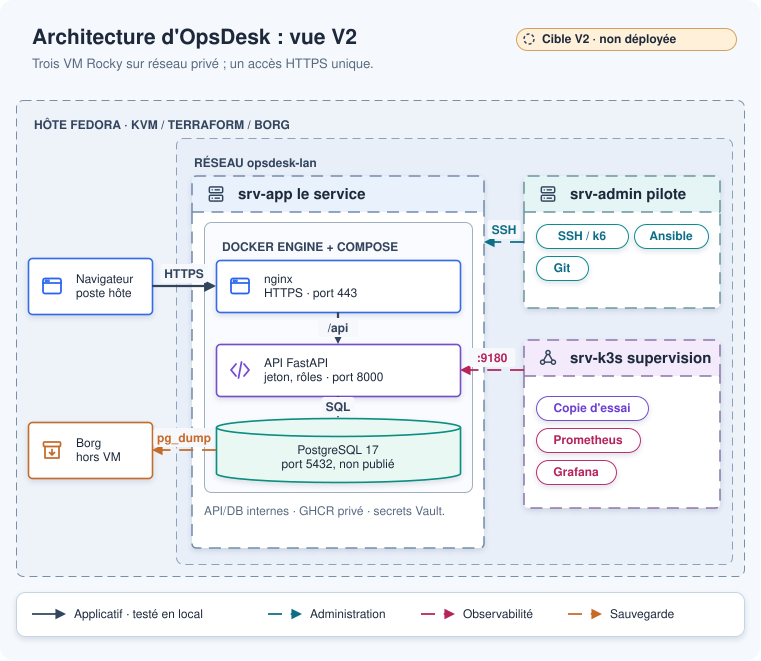

<p align="center">
  
</p>

# OpsDesk

**Ingénierie DevOps / InfraOps — construire et exploiter l'infrastructure d'une application de tickets IT.**

OpsDesk est un projet fil rouge : une application de gestion de tickets sert de support pour apprendre à préparer Linux, automatiser l'infrastructure, livrer des services, les surveiller et tester leur reprise.

**[Découvrir](#le-projet-en-30-secondes)** · **[Essayer](#démarrage-rapide)** · **[Comprendre l'architecture](#architecture)** · **[Examiner les preuves](STATUS.md)** · **[Parcourir la documentation](docs/README.md)**

## Le projet en 30 secondes

- **L'application est fournie :** backend FastAPI, frontend React/nginx et PostgreSQL ; son rôle est d'offrir un service réel à exploiter, pas de présenter le développement full stack comme une réalisation personnelle.
- **L'infrastructure est le sujet de mon apprentissage :** Fedora, KVM/libvirt, Rocky Linux, Terraform, Ansible, Docker Compose, GitHub Actions, K3s, observabilité et restauration. Les réalisations personnelles seront datées et vérifiées progressivement.
- **L'état actuel est explicite :** le socle a été qualifié le 19 novembre 2026 sur un runner jetable ; les déploiements et exercices sur mes VM Rocky restent à réaliser. Voir [STATUS.md](STATUS.md) et la [provenance des travaux](docs/provenance.md).

## Mon rôle et ma démarche InfraOps

**L'application** a été développée avec l'aide d'outils d'IA, puis relue, testée et conteneurisée. Elle me sert de service réaliste à exploiter.

**Mon objectif professionnel : devenir ingénieur DevOps spécialisé dans l’automatisation des infrastructures (InfraOps).** L’application est un support, pas un projet de développement full stack. Mon objectif est de transformer un besoin applicatif en une infrastructure Linux reproductible : concevoir le réseau et le stockage, provisionner les machines, sécuriser et configurer les serveurs, déployer des artefacts versionnés, industrialiser la livraison, puis superviser, maintenir, diagnostiquer et restaurer le service. Dans ce parcours, j’apprends à écrire et tester le code d’infrastructure et les automatisations nécessaires ; je lis le code applicatif pour comprendre ses contraintes et collaborer avec le développement. Les exercices et leurs preuves distinguent le travail personnel du socle fourni.

**Où j’en suis :** application et pile locale qualifiées le 19 novembre 2026 sur un runner jetable : tests SQLite et PostgreSQL, compilation, smoke HTTP, isolation des ports, reprise de l’API et de la base, persistance. L’infrastructure du laboratoire reste à construire personnellement. Voir les [preuves datées et leurs limites](STATUS.md).

## Aperçu de l'application

<picture>
  <source media="(prefers-color-scheme: dark)" srcset="docs/images/apercu-sombre.png">
  
</picture>

<sub>Capture réelle de la version 2.0.0, prise le 18 novembre 2026 sur l'environnement local, avec les données de démonstration.</sub>

La capture représente l'application fournie, avec des données fictives. Elle ne démontre pas le déploiement de mon infrastructure InfraOps.

## Démarrage rapide

Prérequis : Git et Docker avec le plugin Compose.

```bash
git clone https://github.com/mathiasseguincadiche/OpsDesk.git
cd OpsDesk
docker compose up -d --build
```

Ouvrez [http://localhost:8080](http://localhost:8080) une fois les conteneurs démarrés, puis choisissez un compte de démonstration. Aucune configuration préalable n'est nécessaire sur un dépôt fraîchement cloné.

Pour arrêter le projet sans perdre les tickets : `docker compose down`.

La démonstration utilise des données fictives et des ports accessibles uniquement depuis votre poste. Pour les contrôles, les options de configuration ou un problème de démarrage, consultez le [guide de démarrage](docs/demarrage.md). Le déploiement sur serveur est traité séparément dans la [référence technique](docs/reference-technique.md#déployer-avec-docker-compose-sur-un-serveur).

## Architecture

<a href="docs/diagrams/architecture.svg"></a>

**En résumé :** le navigateur parle uniquement au **frontend** (nginx, port 8080). Celui-ci sert l'interface et transmet les appels `/api` à l'**API** (FastAPI, port 8000), qui lit et écrit dans **PostgreSQL**. Dans l'environnement d'exploitation simulée, les trois tourneront sur `srv-app` sous Docker Engine, décrits par un fichier Compose et déployés par Ansible. En pointillés, ce qui reste à construire.

[Voir le schéma détaillé](docs/diagrams/architecture.svg) (ports, flux d'administration, de supervision et de sauvegarde) · [Les choix techniques expliqués](docs/architecture.md)

### Pourquoi ces choix

| Choix | Raison | Limite assumée |
| --- | --- | --- |
| **Docker Engine + Compose** sur le serveur | Les outils de conteneurs les plus répandus en entreprise ; un fichier versionné décrit toute la pile, et Docker la relance au boot | Démon en root : le groupe `docker` vaut root, donc administration par `sudo`. Un seul serveur : pas de haute disponibilité |
| **Trois conteneurs séparés** | Chaque partie se met à jour, se surveille et se redémarre indépendamment | Plus d'éléments à configurer qu'un seul conteneur |
| **K3s sur une copie d'essai** | Apprendre Kubernetes sans risquer le service principal | La copie n'est pas le service réel |

## Ce que montre ce projet

| État technique | Réalisation ou objectif | Où l'examiner |
| --- | --- | --- |
| ✅ Réalisé | Conteneurisation | [`backend/Dockerfile`](backend/Dockerfile), [`frontend/Dockerfile`](frontend/Dockerfile) : images multi-étapes, non-root ; [`compose.yaml`](compose.yaml) : sondes, réseaux séparés, rotation des journaux |
| ✅ Réalisé | Tests automatisés | [`backend/tests/`](backend/tests/) : 28 tests, joués sur SQLite et sur PostgreSQL 17 |
| ✅ Réalisé | Sondes, métriques, journaux | `/health/live`, `/health/ready`, `/metrics` (Prometheus), journaux JSON : voir la [référence technique](docs/reference-technique.md#points-daccès-pour-lexploitation) |
| 🔜 Prévu | Déploiement Docker Compose | Docker Engine sur Rocky Linux, SELinux et firewalld actifs, déployé par Ansible |
| 🔜 Prévu | Infrastructure as Code | Terraform (libvirt) et Ansible depuis `srv-admin` |
| 🔜 Prévu | Livraison continue | GitHub Actions : tests, build, scan Trivy, publication |
| 🔜 Prévu | Supervision et sauvegarde | Prometheus, Grafana, `pg_dump` avec test de restauration |

Les trois premières lignes décrivent le socle fourni et qualifié, pas des compétences personnelles déjà acquises. Les réalisations suivantes seront vérifiées au fil du parcours ; [STATUS.md](STATUS.md) sépare avancement et contrôle. Les preuves personnelles, distinctes, se consignent dans le suivi de formation.

## Parcours de lecture recommandé

- **Découvrir en quelques minutes :** lire la finalité et la contribution personnelle, regarder le schéma de présentation, puis consulter les limites du [statut](STATUS.md).
- **Reproduire la pile locale :** suivre le [démarrage](docs/demarrage.md), vérifier les trois services, la disponibilité et un parcours de ticket ; ne pas confondre ce contrôle avec le laboratoire Rocky.
- **Analyser comme ingénieur :** lire le [contrat applicatif](docs/contrat-applicatif.md), les [décisions d'architecture](docs/architecture.md#décisions-retenues) et les [preuves](docs/preuves.md) ; toute cible prévue reste non vérifiée.
- **Construire son autonomie :** suivre les [13 exercices](docs/apprentissage/README.md) puis les évaluations ; le cours Notion est complémentaire, non requis pour démarrer l'application.

## Ce que fait l'application

- **Trois rôles** : le collaborateur ouvre et suit ses demandes ; le support les prend en charge et les résout ; l'administrateur gère aussi les comptes.
- **Un cycle de vie clair** : ouvert → en cours → résolu → clôturé, avec réouverture possible. Le demandeur confirme lui-même la résolution.
- **Le suivi** : commentaires, historique de chaque changement, recherche, filtres.
- **Un tableau de bord** : tickets actifs, activité sur 14 jours, charge de l'équipe.

## Documentation

L'[index de la documentation](docs/README.md) regroupe tous les guides, exercices, procédures et preuves par besoin. Voici les accès principaux.

| Pour… | Lire |
| --- | --- |
| Comprendre les choix techniques et leurs compromis | [Architecture](docs/architecture.md) |
| Examiner ce que l'application exige de l'infrastructure | [Contrat applicatif](docs/contrat-applicatif.md) |
| Exploiter, configurer, déployer, tester | [Référence technique](docs/reference-technique.md) · [Exploitation](docs/exploitation-day2.md) · [Reprise](docs/reprise.md) |
| Examiner la sécurité, les résultats et leurs limites | [Sécurité](docs/securite.md) · [Preuves](docs/preuves.md) |
| Préparer une démonstration technique | [Démonstration](docs/demonstration.md) |
| Préparer le laboratoire Fedora, KVM et Rocky Linux | [Guide du laboratoire](docs/laboratoire-fedora-kvm-rocky.md) |
| Suivre l'avancement et les preuves | [STATUS.md](STATUS.md) · [Feuille de route](ROADMAP.md) |
| Apprendre pas à pas | [Les 13 exercices](docs/apprentissage/README.md), énoncés de référence pour la v2 · cours complet dans le centre de formation Notion (accès sur invitation) |
| Consulter la version 1 | [`legacy/`](legacy/) |

## Contribuer ou reprendre le projet

Pour signaler un bug ou proposer une modification, lire le [guide de contribution](CONTRIBUTING.md), la [politique de sécurité](SECURITY.md) et la [charte GitHub InfraOps](docs/CHARTE_GITHUB.md). Pour comprendre les versions, consulter le [journal des changements](CHANGELOG.md).

Lire d'abord le [contrat applicatif](docs/contrat-applicatif.md) et le [registre des décisions](docs/architecture.md#décisions-retenues). Pour signaler un problème, indiquer la version, la cible, les étapes de reproduction et les résultats attendus/observés, sans secret ni donnée personnelle. Pour proposer une correction, partir de `main` sur une branche dédiée, expliquer le besoin et les conséquences, vérifier le périmètre modifié et joindre les preuves dans une pull request. Si un changement touche la documentation ou un schéma, contrôler les liens, la cohérence avec le code et la source Draw.io ; ne pas transférer un ancien résultat à une nouvelle configuration. Les exercices restent des réalisations personnelles : différencier un exemple, une contribution et un acquis de formation.

## Licence et provenance

Code sous licence [MIT](LICENSE). L'application a été développée avec l'assistance d'outils d'IA ; l'infrastructure et son exploitation constituent le travail personnel à réaliser et à prouver ; leur état réel est documenté dans [STATUS.md](STATUS.md). Les composants tiers (FastAPI, React, PostgreSQL, nginx…) conservent leurs propres licences. Détails : [provenance](docs/provenance.md).
