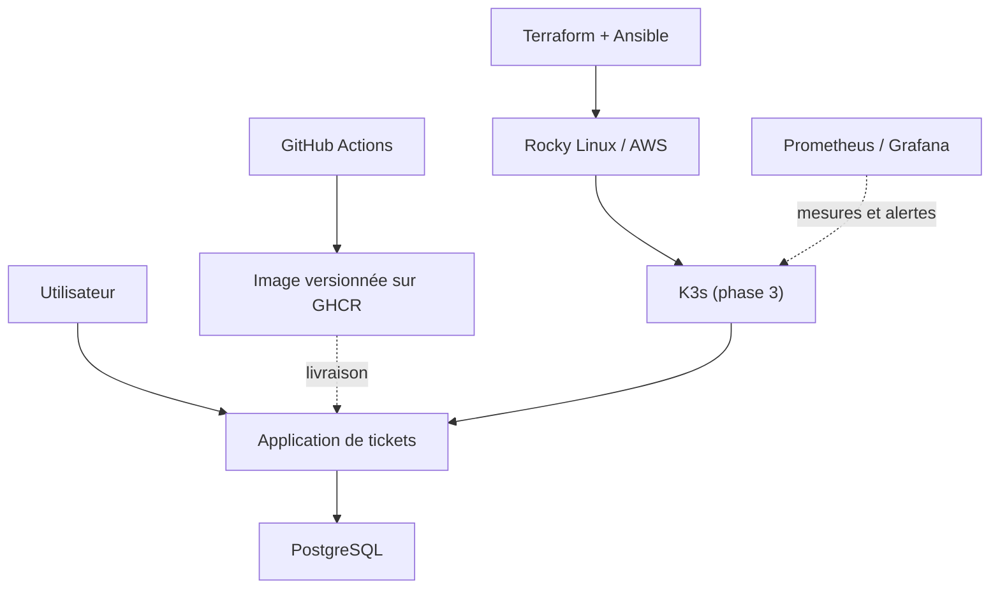

# OpsDesk — livrer et exploiter une application de tickets IT

> **État : architecture et parcours préparés.** L’application, les déploiements et les validations techniques restent à réaliser. Voir [STATUS.md](STATUS.md).

## Le projet en 30 secondes

Une équipe informatique doit pouvoir enregistrer, suivre et résoudre ses demandes. OpsDesk prend cette application de tickets comme **fil rouge** pour apprendre tout le cycle InfraOps : faire fonctionner un service, le livrer, reconstruire son infrastructure, puis l’exploiter et diagnostiquer ses incidents.

Une seule application et trois phases progressives, dans **un seul dépôt**.

| Phase | Problème concret | Technologies visées | Preuve attendue |
| --- | --- | --- | --- |
| 1. Livraison | Comment fournir une version testée, identifiable et relançable ? | Application de tickets, PostgreSQL, Docker Compose, GitHub Actions, GHCR, Trivy | Démonstration CRUD, tests réels, image versionnée et rapport d’analyse |
| 2. Infrastructure | Comment reconstruire un serveur sécurisé de façon répétable ? | AWS, Terraform, Rocky Linux, Ansible, SELinux/firewalld | Plan et configuration reproductibles, validation d’idempotence, nettoyage du labo |
| 3. Exploitation | Comment détecter un problème et rétablir le service ? | K3s, Prometheus, Grafana, journaux, alertes, k6 | Déploiement vérifié, incident simulé, métriques et test de charge documentés |

La phase 1 doit fonctionner **localement**, sans cloud ni Kubernetes. On n’ajoute une nouvelle couche qu’après avoir compris et validé la précédente.

## Architecture visée — non déployée

Ce diagramme décrit la **cible finale**, pas un résultat déjà obtenu. Le mode local Compose et le mode K3s seront deux manières de déployer la *même* application.

## Où commencer ?

1. Lire [l’état réel](STATUS.md), sans confondre objectifs et réalisations.
2. Suivre la [feuille de route](ROADMAP.md), phase par phase.
3. Comprendre les [choix d’architecture](docs/architecture.md).
4. Travailler avec le [parcours pédagogique](docs/parcours-apprentissage.md).
5. Vérifier les [prérequis et le premier jalon](docs/demarrage.md).

Lors de l’implémentation, les dossiers apparaîtront au besoin : `app/`, `tests/`, `deploy/compose/`, `infra/terraform/`, `infra/ansible/`, `deploy/k3s/`, `.github/workflows/` et `docs/preuves/`. Aucun dossier vide n’est créé pour simuler une réalisation.

## Règles de travail

- **Expliquer avant d’automatiser** : objectif, solution minimale, validation, panne volontaire, bilan.
- **Ne jamais publier de secret** : tokens, fichiers `.env`, clés privées, états Terraform, sauvegardes et données personnelles restent hors Git.
- **Ne pas provoquer de frais cloud sans préparation** : budget, estimation, contrôle des accès et plan de destruction avant AWS.
- **Ne pas confondre un pipeline vert avec une preuve** : résultats de tests réellement exécutés, limites et incidents conservés.
- Pour les 16 modules de formation OpsDesk, Notion sert de support pédagogique ; GitHub garde les sources, décisions et preuves reproductibles.

Projet personnel de **Mathias SEGUIN-CADICHE**, pour construire et démontrer des bases solides en DevOps / InfraOps.