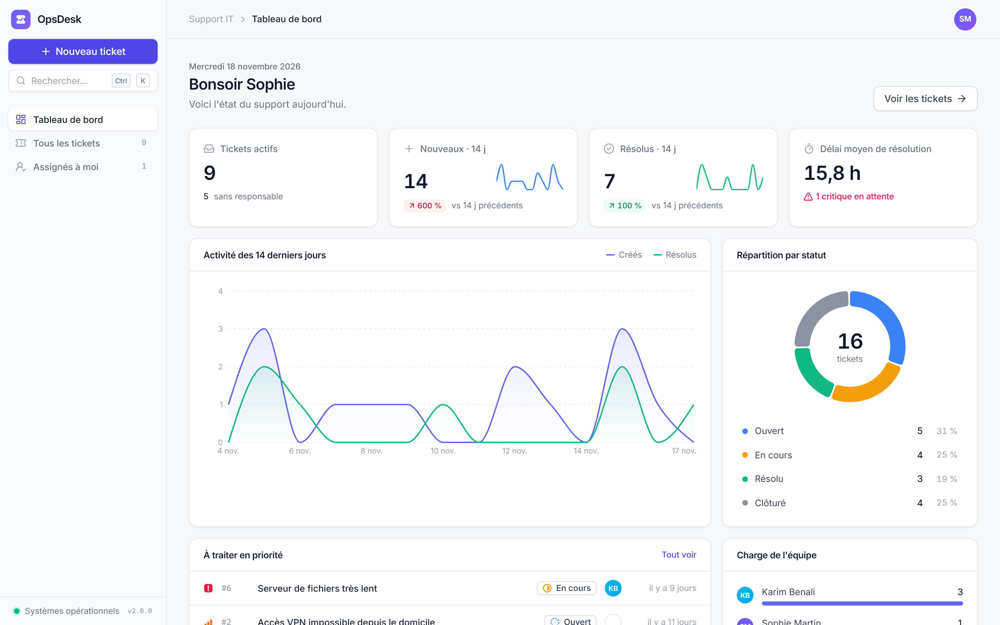

# OpsDesk - Application de Gestion de ticket IT

**Une application de tickets IT, et l'infrastructure qui la fait tourner en production.**

Un collaborateur signale une panne, l'équipe support la prend en charge, la résout, et chacun suit l'avancement en temps réel. OpsDesk sert de support à un projet DevOps complet : conteneuriser, déployer, automatiser, surveiller et sauvegarder un vrai service, avec une preuve datée pour chaque étape.

**Essayer** : [lancer en 2 minutes](#lancer-le-projet-en-local) · **Examiner** : [architecture et choix](#architecture) · **Évaluer** : [compétences](#ce-que-montre-ce-projet) et [état d'avancement](STATUS.md) · **Approfondir** : [référence technique](docs/reference-technique.md)

<picture>
  <source media="(prefers-color-scheme: dark)" srcset="docs/images/apercu-sombre.png">
  
</picture>
<sub>Capture réelle de la version 2.0.0, prise le 18 novembre 2026 sur l'environnement local, avec les données de démonstration.</sub>

## Mon rôle dans ce projet

**L'application** a été développée avec l'aide d'outils d'IA, puis relue, testée et conteneurisée. Elle me sert de service réaliste à exploiter.

**Mon travail** consiste à concevoir et automatiser son infrastructure : machines virtuelles, déploiement, livraison continue, supervision et sauvegarde.

**Où j'en suis :** l'application et ses conteneurs sont prêts et testés. L'infrastructure se construit étape par étape, avec une preuve datée pour chaque résultat.

## Ce que montre ce projet

| État | Compétence | Où la voir |
| --- | --- | --- |
| ✅ Réalisé | Conteneurisation | [`backend/Containerfile`](backend/Containerfile), [`frontend/Containerfile`](frontend/Containerfile) : images multi-étapes, non-root |
| ✅ Réalisé | Tests automatisés | [`backend/tests/`](backend/tests/) : 19 tests, joués sur SQLite et sur PostgreSQL 17 |
| ✅ Réalisé | Sondes, métriques, journaux | `/health/live`, `/health/ready`, `/metrics` (Prometheus), journaux JSON : voir la [référence technique](docs/reference-technique.md#points-daccès-pour-lexploitation) |
| 🔜 Prévu | Déploiement Podman + Quadlet | Unités systemd sur Rocky Linux |
| 🔜 Prévu | Infrastructure as Code | Terraform (libvirt) et Ansible depuis `srv-admin` |
| 🔜 Prévu | Livraison continue | GitHub Actions : tests, build, scan Trivy, publication |
| 🔜 Prévu | Supervision et sauvegarde | Prometheus, Grafana, `pg_dump` avec test de restauration |

Chaque ligne passe à « Réalisé » seulement avec une preuve consultable. Le détail daté, y compris les échecs, est dans [STATUS.md](STATUS.md).

## Architecture

<a href="docs/diagrams/architecture.svg"></a>

**En résumé :** le navigateur parle uniquement au **frontend** (nginx, port 8080). Celui-ci sert l'interface et transmet les appels `/api` à l'**API** (FastAPI, port 8000), qui lit et écrit dans **PostgreSQL**. En production, les trois tourneront dans des conteneurs Podman sur `srv-app`, démarrés par systemd grâce à Quadlet. En pointillés, ce qui reste à construire.

[Voir le schéma détaillé](docs/diagrams/architecture.svg) (ports, flux d'administration, de supervision et de sauvegarde) · [Les choix techniques expliqués](docs/architecture.md)

### Pourquoi ces choix

| Choix | Raison | Limite assumée |
| --- | --- | --- |
| **Podman + Quadlet** plutôt que Docker Compose | Conteneurs sans root, gérés par systemd : redémarrage automatique, démarrage au boot, journaux dans journald | Un seul serveur : pas de haute disponibilité |
| **Trois conteneurs séparés** | Chaque partie se met à jour, se surveille et se redémarre indépendamment | Plus d'éléments à configurer qu'un seul conteneur |
| **K3s sur une copie d'essai** | Apprendre Kubernetes sans risquer le service principal | La copie n'est pas le service réel |

## Lancer le projet en local

Il vous faut Podman (ou Docker) et Git. Comptez deux minutes.

**1. Récupérer le projet et préparer la configuration**

```bash
git clone https://github.com/mathiasseguincadiche/OpsDesk.git && cd OpsDesk
cp .env.example .env
```

Ouvrez `.env` et remplacez les trois valeurs `change-me` par vos propres mots de passe.

**2. Démarrer les trois conteneurs**

```bash
podman compose up -d --build
```

**3. Vérifier que tout fonctionne**

```bash
podman compose ps
```

Les trois services doivent afficher `healthy`. Ouvrez ensuite **http://localhost:8080** et cliquez sur un compte de démonstration pour vous connecter.

> [!NOTE]
> Ce mode local sert aux essais. En production, chaque conteneur sera géré par systemd via Quadlet : les contraintes à respecter sont dans la [référence technique](docs/reference-technique.md#déployer-avec-podman-et-quadlet).

## Ce que fait l'application

- **Trois rôles** : le collaborateur ouvre et suit ses demandes ; le support les prend en charge et les résout ; l'administrateur gère aussi les comptes.
- **Un cycle de vie clair** : ouvert → en cours → résolu → clôturé, avec réouverture possible. Le demandeur confirme lui-même la résolution.
- **Le suivi** : commentaires, historique de chaque changement, recherche, filtres.
- **Un tableau de bord** : tickets actifs, activité sur 14 jours, charge de l'équipe.

## Documentation

| Pour… | Lire |
| --- | --- |
| Comprendre les choix techniques et leurs compromis | [Architecture](docs/architecture.md) |
| Exploiter, configurer, déployer, tester | [Référence technique](docs/reference-technique.md) |
| Préparer le laboratoire Fedora, KVM et Rocky Linux | [Guide du laboratoire](docs/laboratoire-fedora-kvm-rocky.md) |
| Suivre l'avancement et les preuves | [STATUS.md](STATUS.md) · [Feuille de route](ROADMAP.md) |
| Apprendre pas à pas | [Les 13 exercices](docs/apprentissage/README.md), énoncés de référence pour la v2 · cours complet dans le centre de formation Notion (accès sur invitation) |
| Consulter la version 1 | [`legacy/`](legacy/) |

## Licence et provenance

Code sous licence [MIT](LICENSE). L'application a été développée avec l'assistance d'outils d'IA ; l'infrastructure et son exploitation sont mon travail personnel, documenté et daté dans [STATUS.md](STATUS.md). Les composants tiers (FastAPI, React, PostgreSQL, nginx…) conservent leurs propres licences. Détails : [provenance](docs/provenance.md).
