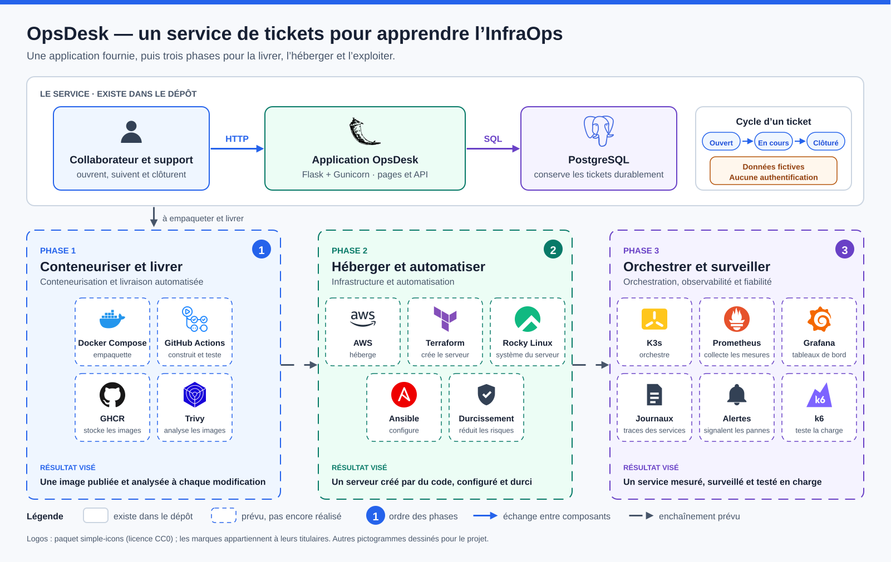

# OpsDesk — un service de tickets pour apprendre l’InfraOps

OpsDesk est une petite application de tickets IT. Un collaborateur ouvre une demande, le support la suit puis la clôture ; PostgreSQL conserve les tickets. Le projet sert de fil rouge pour apprendre à livrer, héberger et exploiter un service.

## Problème et objectif

Écrire une application ne suffit pas : il faut aussi la livrer, la faire tourner et la maintenir. OpsDesk fournit une application déjà écrite, pour travailler uniquement sur l’infrastructure. L’application tourne d’abord en local ; trois phases sont ensuite prévues, dans l’ordre : **préparer et automatiser** (deux serveurs, Terraform, Ansible, conteneurs Podman), **livrer et conserver** (livraison automatisée, analyse de l’image, sauvegarde et restauration), **orchestrer et maintenir** (K3s sur une copie d’essai de l’application, supervision, test de charge). Le détail est dans le [parcours](docs/parcours-apprentissage.md).

## État du projet

| Élément | Avancement | Contrôle | Preuve et portée |
| --- | --- | --- | --- |
| Application (pages, API, base) | Réalisé | Vérifié : 26 tests réussis le 3 novembre 2026 | [Rapport](evidence/qualification/application-tests.json) ; processus de développement ponctuel |
| Analyse de vulnérabilités de l’image | Réalisé | Échec constaté : 185 occurrences, dont 45 HIGH | [Rapport](evidence/vulnerability-scan.json) et [triage](docs/triage-securite.md) ; image historique |
| Trois phases d’infrastructure | Prévu | Non vérifié : aucun déploiement ni pipeline exécuté | [État détaillé](STATUS.md) |
| Laboratoire Fedora, KVM, Rocky Linux | Prévu | Non vérifié : aucune machine préparée | [Guide du laboratoire](docs/laboratoire-fedora-kvm-rocky.md) |

## Pour commencer

Aucune installation n’est nécessaire pour le premier exercice. Lire le [contrat applicatif](docs/contrat-applicatif.md), puis l’[exercice 1](docs/apprentissage/01-application.md) : comprendre l’application et reformuler ses besoins. Les [13 exercices](docs/apprentissage/README.md) se suivent dans l’ordre. La [page Notion](https://app.notion.com/p/3fc65721fa1881ad8325c8c4619c7223) présente le même parcours de façon guidée.

## Limites

- **Aucune authentification** : données fictives, usage de laboratoire uniquement. Aucun usage public ni production.
- L’essai historique sur Ubuntu/WSL2 avec Docker Compose n’est plus rejouable : ses fichiers de configuration ne sont pas dans le dépôt.
- La sécurité de l’image n’est pas validée.
- Aucun exercice d’infrastructure n’a été réalisé à ce jour.

## Pour aller plus loin

[Architecture](docs/architecture.md) · [Sécurité](docs/securite.md) · [Preuves](docs/preuves.md) · [Provenance](docs/provenance.md) · [Feuille de route](ROADMAP.md) · [Licence MIT](LICENSE)
