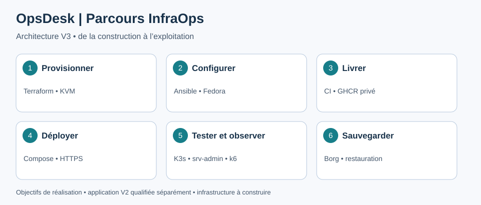

# OpsDesk

**Projet InfraOps pour apprendre à provisionner, déployer et exploiter une application de tickets IT.**

**[Voir le parcours](#le-projet-en-30-secondes)** · **[Comprendre l’architecture](#architecture)** · **[Essayer l’application](#démarrage-rapide)** · **[Vérifier l’avancement](STATUS.md)** · **[Consulter la documentation](#documentation)**

## Le projet en 30 secondes

OpsDesk fournit un service de tickets composé d’un frontend React/nginx, d’une API FastAPI et d’une base PostgreSQL. Il sert de support à un parcours d’ingénierie DevOps qui va du provisionnement Linux à la restauration des données.

| En place | À réaliser |
| --- | --- |
| Pile applicative conteneurisée et qualifiée sur runner Ubuntu. La validation du 22 novembre 2026 couvre les tests, la compilation et le parcours HTTP. | Laboratoire Fedora/Rocky, déploiement automatisé, livraison des images, supervision et reprise sur les VM. |

[](docs/presentation-projet-infraops-v3.md)

[Lire la présentation des six étapes](docs/presentation-projet-infraops-v3.md) · [Suivre la feuille de route](ROADMAP.md)

### Le défi d'infrastructure

Rendre le service reproductible, observable et restaurable. Chaque jalon associe un besoin, un choix technique et un contrôle à réaliser.

## Mon rôle dans ce projet

Je me forme à l’ingénierie DevOps, avec une spécialisation en automatisation des infrastructures. Mon périmètre couvre le réseau et le stockage, le provisionnement, la configuration, le déploiement et l’exploitation du laboratoire. Le socle applicatif a été développé avec l’aide d’outils d’IA, puis relu, testé et conteneurisé. [Provenance des travaux](docs/provenance.md) · [Preuves et limites](STATUS.md)

## Architecture

L’architecture d’infrastructure V3 a été validée en conception le 25 novembre 2026. Fedora pilote Terraform et Ansible : trois VM Rocky sont provisionnées, amorcées par cloud-init puis configurées par SSH. `srv-app` héberge le service Compose, `srv-ops` la supervision indépendante et `srv-k3s` la copie d’essai. k6 s’exécute à la demande depuis Fedora. L’application reste en version 2. Fedora et ces trois VM constituent également l’intégralité du laboratoire d’apprentissage : aucune VM supplémentaire n’est prévue.

<a href="docs/diagrams/architecture-globale-v3.svg"></a>

[Ouvrir le schéma](docs/diagrams/architecture-globale-v3.svg) · [Sept ADR](docs/adr/README.md) · [Principes des flux](docs/architecture-v3-flux.md) · [Plan de déploiement](docs/architecture-v3-deploiement.md)

### Pourquoi ces choix

- **Docker Compose** décrit la pile du service principal. Nginx expose HTTPS sur le port 443 et relaie `/api` vers FastAPI. L’API et PostgreSQL communiquent sur le réseau interne.
- **K3s** sert aux essais sur une copie isolée, où l’on peut tester de nouvelles versions et la charge, en bornant les ressources et en vérifiant l’absence d’impact sur le service principal.
- **Prometheus, Grafana, Blackbox Exporter et Borg** couvrent la supervision et la sauvegarde hors VM. La validation sur le laboratoire reste à réaliser.

[Architecture et choix techniques](docs/architecture.md) · [Contrat applicatif](docs/contrat-applicatif.md)

## Aperçu de l'application

<picture>
  <source media="(prefers-color-scheme: dark)" srcset="docs/images/apercu-sombre.png">
  
</picture>

<sub>Tableau de bord de la version 2.0.0 en local, capturé le 18 novembre 2026 avec des données fictives.</sub>

## Ce que fait l'application

Le collaborateur ouvre et suit ses tickets. Le support les prend en charge et les résout. L’administrateur gère aussi les comptes. Les tickets passent d’ouvert à en cours, à résolu, puis à clôturé, avec réouverture possible. L’interface propose un suivi des échanges, un historique, des filtres et un tableau de bord.

## Démarrage rapide

Installez Git et Docker avec le plugin Compose, puis lancez ces commandes.

```bash
git clone https://github.com/mathiasseguincadiche/OpsDesk.git
cd OpsDesk
docker compose up -d --build
```

Ouvrez [http://localhost:8080](http://localhost:8080) et choisissez un compte de démonstration. Un clone neuf démarre avec les réglages par défaut. La pile locale utilise des données fictives et n’expose ses ports que sur votre poste. Exécutez `docker compose down` pour l’arrêter en conservant les tickets.

[Guide de démarrage](docs/demarrage.md) · [Déploiement sur serveur](docs/reference-technique.md#déployer-avec-docker-compose-sur-un-serveur)

## Ce que montre ce projet

| Périmètre | État et preuves |
| --- | --- |
| Conteneurisation du socle | Images multi-étapes, exécution non-root et sondes dans les [Dockerfiles backend](backend/Dockerfile) et [frontend](frontend/Dockerfile) ainsi que dans [Compose](compose.yaml). |
| Qualification applicative | 30 tests SQLite, 30 tests PostgreSQL, build frontend et contrôle HTTP Compose sur runner. [CI applicative](docs/ci-applicative.md) |
| Exploitation applicative | Sondes, métriques Prometheus et journaux JSON. La reprise des conteneurs et la persistance ont été testées sur runner. [Points d’accès](docs/reference-technique.md#points-daccès-pour-lexploitation) · [Preuves](docs/preuves.md) |
| Infrastructure personnelle | Provisionnement Terraform/Ansible, livraison GHCR par digest, exploitation Rocky, K3s, supervision et restauration à réaliser et à prouver sur le laboratoire. [État daté](STATUS.md) |

## Documentation

| Pour… | Lire |
| --- | --- |
| Explorer toutes les références | [Index de la documentation](docs/README.md) |
| Exploiter, configurer et restaurer | [Référence technique](docs/reference-technique.md) · [Exploitation](docs/exploitation-day2.md) · [Reprise](docs/reprise.md) |
| Examiner la sécurité et les résultats | [Sécurité](docs/securite.md) · [Preuves](docs/preuves.md) |
| Consulter la version 1 | [Archives de la V1](legacy/) |

La table d’adressage complète et la matrice de flux détaillée sont réservées au dossier privé Notion.

## Contribuer ou reprendre le projet

Consultez le [guide de contribution](CONTRIBUTING.md), la [politique de sécurité](SECURITY.md) et le [journal des changements](CHANGELOG.md). Pour proposer une correction, ouvrez une pull request depuis une branche dédiée et joignez les contrôles exécutés. Pour signaler un problème, indiquez la version et les étapes de reproduction, sans secret ni donnée personnelle.

## Licence et provenance

Code sous licence [MIT](LICENSE). Les composants tiers conservent leurs propres licences. [Provenance et attribution](docs/provenance.md)
