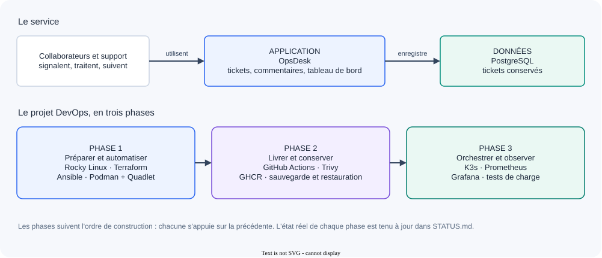

# OpsDesk

**Construire, automatiser et exploiter l’infrastructure d’un service de tickets IT.**

OpsDesk est un laboratoire personnel InfraOps. Un collaborateur ouvre une demande, le support la suit et la clôture. L’application Flask et PostgreSQL fournit le besoin métier ; le travail InfraOps consiste à rendre ce service déployable, observable et restaurable.

[Architecture](docs/architecture.md) · [Parcours pratique](docs/apprentissage/README.md) · [Documentation](docs/README.md) · [État et preuves](STATUS.md) · [Notion](https://app.notion.com/p/3fc65721fa1881ad8325c8c4619c7223)

## Ce que le projet permet de construire

| Phase | Responsabilité InfraOps | Technologies cibles |
| --- | --- | --- |
| 1 — Préparer et automatiser | Provisionner des VM, configurer Linux et exécuter le service | Fedora, KVM/libvirt, Rocky Linux, Terraform, Ansible, Podman |
| 2 — Livrer et conserver | Construire et contrôler une image, livrer une version, protéger les données | GitHub Actions, GHCR, Trivy, pg_dump, rsync |
| 3 — Orchestrer et maintenir | Expérimenter l’orchestration, mesurer et diagnostiquer | K3s, Prometheus, Grafana, k6 |

Ces trois phases décrivent la cible, non un déploiement déjà livré. Les [13 exercices personnels](docs/apprentissage/README.md) suivent un ordre pédagogique distinct.

## Le service

*Capture de l’essai historique ; le rendu de la version actuelle n’a pas été requalifié.*

L’application expose des pages HTML et une API JSON. PostgreSQL conserve les demandes et leurs statuts. Les endpoints de santé et de métriques permettent d’étudier les contrôles d’exploitation.

Le [contrat applicatif](docs/contrat-applicatif.md) précise les routes, paramètres, dépendances et limites du service.

## Architecture cible

| Environnement | Rôle |
| --- | --- |
| Hôte Fedora 45 / KVM | Héberger les trois VM et les sauvegardes hors VM |
| `srv-admin` — Rocky Linux 10.2 | Administrer avec Terraform, Ansible, Git et SSH ; lancer les tests k6 |
| `srv-app` — Rocky Linux 10.2 | Exécuter OpsDesk et PostgreSQL avec Podman |
| `srv-k3s` — Rocky Linux 10.2 | Héberger une copie d’essai indépendante, Prometheus et Grafana |

[Voir le schéma technique et les décisions](docs/architecture.md) · [Sources Draw.io](docs/diagrams/README.md)

K3s ne pilote pas les conteneurs Podman de `srv-app` : la copie d’essai sert à apprendre Kubernetes, indépendamment du service principal.

## État et preuves

| Périmètre | Résultat établi |
| --- | --- |
| Application fournie | 26 tests réussis le 3 novembre 2026 — [rapport](evidence/qualification/application-tests.json) |
| Sécurité de l’image historique | Échec constaté : 185 occurrences, dont 45 HIGH — [triage](docs/triage-securite.md) |
| Infrastructure, CI/CD, laboratoire | Prévus ; aucun déploiement ni pipeline personnel vérifié |

Les tests applicatifs portent sur un processus ponctuel avec PostgreSQL existant. Ils ne qualifient pas le laboratoire Fedora/Rocky ni la compétence personnelle de l’apprenant. L’essai Ubuntu/WSL2 avec Docker Compose demeure historique et n’est plus rejouable depuis cette arborescence. Le service n’a pas d’authentification : données fictives, laboratoire uniquement, ni exposition Internet ni production.

[État détaillé](STATUS.md) · [Interpréter les preuves](docs/preuves.md)

## Commencer

**Aucune installation nécessaire pour la première séance.** Lire le [contrat applicatif](docs/contrat-applicatif.md), puis [l’exercice 01](docs/apprentissage/01-application.md) et expliquer le trajet d’un ticket.

Ensuite, suivre [les 13 exercices](docs/apprentissage/README.md) et le [guide de préparation des outils et du laboratoire](docs/laboratoire-fedora-kvm-rocky.md). Les configurations d’infrastructure restent à écrire et à vérifier personnellement.

## Explorer le dépôt

| Emplacement | Contenu |
| --- | --- |
| [app/](app/) | Application Python, pages HTML et API |
| [db/](db/) | Schéma PostgreSQL |
| [tests/](tests/) | Tests unitaires et d’intégration fournis |
| [scripts/](scripts/) | Contrôle métier HTTP fourni |
| [docs/](docs/README.md) | Contrat, architecture, exercices et exploitation |
| [evidence/](evidence/) | Rapports et observations datés ; portée décrite dans les preuves |

[Feuille de route](ROADMAP.md) · [Provenance](docs/provenance.md) · [Licence MIT](LICENSE)
