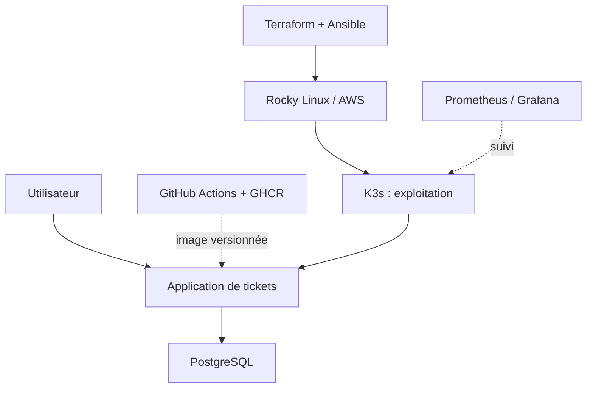

# OpsDesk — livraison et exploitation d'une application de tickets IT

**Projet personnel InfraOps** · Application / CI-CD / Infrastructure as Code / Kubernetes / Observabilité

> **État réel : conception documentée ; réalisation et validations à venir.** [Voir l'avancement et les preuves](STATUS.md).

## En 30 secondes

Une équipe IT doit pouvoir créer et suivre ses tickets sans perdre ses données. **OpsDesk** prend ce service concret comme fil conducteur pour démontrer comment **livrer une application, reconstruire son environnement et l'exploiter en cas d'incident**.

Le même service évoluera en trois étapes — sans repartir de zéro ni empiler les outils inutilement.

| Étape | Réalisation visée | Ce qui permettra de la vérifier |
| --- | --- | --- |
| **1. Livrer** | Tickets + PostgreSQL sous Docker Compose ; GitHub Actions, GHCR et Trivy | Démo fonctionnelle, tests automatisés, image reliée au commit, rapport d'analyse |
| **2. Déployer** | Serveur Rocky Linux sur AWS avec Terraform et Ansible | Recréation documentée, configuration contrôlée, vérification d'idempotence |
| **3. Exploiter** | K3s, métriques Prometheus/Grafana, journaux, alertes, tests k6 | Service vérifié, incident simulé, diagnostic, mesures et reprise |

**Point de départ :** la première étape doit marcher localement, sans AWS ni Kubernetes.

## Architecture cible

*Schéma de la cible finale, non d'une infrastructure déjà déployée.*

## Ce qu'on pourra examiner

- Le code de l'application et les tests du scénario **créer → suivre → clôturer un ticket**.
- La chaîne **commit → tests → image → déploiement**, avec les vrais résultats de CI et de sécurité.
- La reconstruction de l'infrastructure et les contrôles de configuration.
- Une démonstration d'incident : **signal → diagnostic → correction → vérification**.

**Aujourd'hui, ces preuves sont à produire**, pas à supposer : leur progression est suivie dans [STATUS.md](STATUS.md).

## Deux chemins de lecture

- **Évaluer le projet :** [état et preuves](STATUS.md) · [jalons et critères de réussite](ROADMAP.md) · [architecture détaillée](docs/architecture.md).
- **Apprendre et reproduire :** [parcours expliqué](docs/parcours-apprentissage.md) · [première séance et prérequis](docs/demarrage.md).

Les sources, configurations, workflows et résultats seront ajoutés progressivement, lorsqu'ils existent et sont vérifiés. Aucun secret ni état Terraform sensible ne doit être committé ; aucun laboratoire AWS ne sera lancé sans budget et nettoyage prévus.

**Mathias SEGUIN-CADICHE** · Projet personnel DevOps, spécialisation InfraOps.