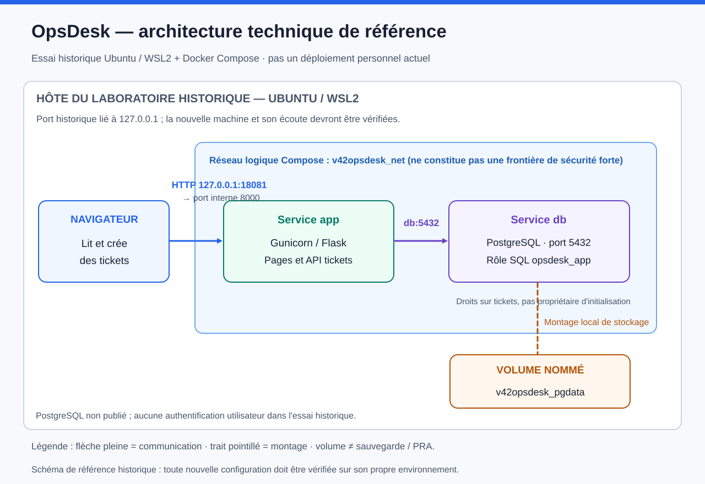
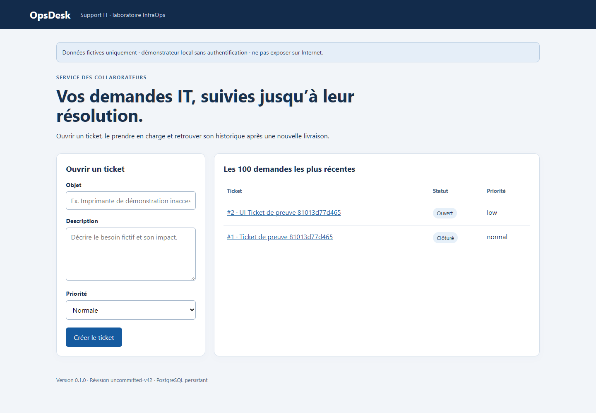

# OpsDesk — Déploiement et exploitation sur Linux

**Portfolio DevOps · Infrastructure et automatisation**

OpsDesk est un service de tickets pour un laboratoire d’infrastructure. Un utilisateur ouvre un ticket, le support le suit et PostgreSQL en conserve l’état. L’application Flask et ses tests sont fournis. Le projet porte sur le provisionnement, la configuration, la livraison et l’exploitation du service.

**Contribution actuelle.** Conception du laboratoire local, choix d’architecture documentés et préparation des contrôles de mise en service.

**Prochain résultat à démontrer.** Provisionner `srv-app` avec Terraform, la configurer avec Ansible, puis déployer avec Podman et Quadlet. Rejouer la configuration et relire un ticket après redémarrage. **Jalon prévu.**

**[Commencer par la revue du projet](docs/demonstration.md)** · [Architecture et schéma technique](#architecture-cible) · [État et preuves](STATUS.md) · [Centre de formation Notion (accès selon droits)](https://app.notion.com/p/41b65721fa18812598c1cde5c24878d9)

> Laboratoire privé, données fictives et service sans authentification. La revue documentaire est accessible sans démarrer le laboratoire.

[Voir le schéma de présentation en grand](docs/diagrams/presentation.svg)

## Architecture cible

Le schéma technique montre les trois VM du laboratoire, la chaîne de livraison, les flux réseau et la sauvegarde de PostgreSQL.

[Voir le schéma technique en grand](docs/diagrams/architecture-technique.svg) · [Sources Draw.io et flux réseau](docs/diagrams/README.md)

| Responsabilité | Choix et résultat visé |
| --- | --- |
| **Provisionner et configurer** | `srv-admin` pilote Terraform/libvirt et Ansible. `srv-app` héberge le service principal et sa base PostgreSQL avec Podman et Quadlet. |
| **Livrer et conserver les données** | GitHub Actions construit et teste l’image. GHCR la distribue et Trivy participe au contrôle. Une sauvegarde hors VM sert de point de départ à la restauration. |
| **Orchestrer et observer** | `srv-k3s` accueille une copie d’essai, Prometheus et Grafana. k6 sert aux essais de charge sur cette copie. Le cluster mono-nœud ne fournit pas de haute disponibilité. |

[Lire les choix, leurs limites et les contrôles prévus](docs/architecture.md)

## État et preuves

- **Application fournie.** [26 tests réussis le 3 novembre 2026](evidence/qualification/application-tests.json), sur un environnement de développement ponctuel.
- **Image historique.** [Scan en échec](docs/triage-securite.md), avec 185 occurrences dont 45 HIGH.
- **Infrastructure personnelle.** [Déploiement et chaîne de livraison à réaliser](STATUS.md). Les preuves historiques portent sur leur environnement d’essai.

Voir l’interface historique du service

Capture du 3 novembre 2026. [Observation navigateur datée](evidence/browser.json) · [Contrat applicatif](docs/contrat-applicatif.md)

## Explorer le projet

| Pour | Ressources |
| --- | --- |
| **Comprendre le dossier** | [Index documentaire](docs/README.md) · [Provenance](docs/provenance.md) · [Feuille de route](ROADMAP.md) |
| **Préparer et pratiquer** | [Préparation du laboratoire](docs/laboratoire-fedora-kvm-rocky.md) · [13 exercices](docs/apprentissage/README.md) · [Centre de formation Notion (accès selon droits)](https://app.notion.com/p/41b65721fa18812598c1cde5c24878d9) |
| **Examiner le code fourni** | [Application](app/) · [Base](db/) · [Tests](tests/) · [Scripts](scripts/) |
| **Consulter les traces** | [Preuves](evidence/) · [Références historiques](docs/historique.md) |

Licence [MIT](LICENSE). Les composants tiers conservent leurs propres licences.
