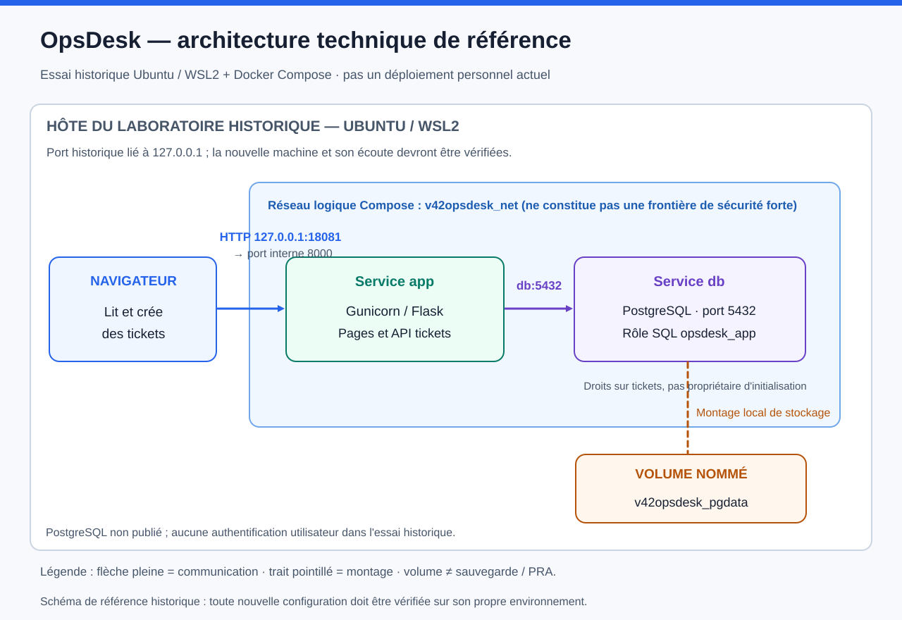

# Architecture opérationnelle d’OpsDesk

**V4.4 : architecture interne de l’application et référence du laboratoire de développement Codex.** La cible d’hébergement reste à concevoir personnellement par Mathias. Les choix Compose, noms de ressources et ports ci-dessous décrivent cet essai historique ; ils ne sont pas une architecture personnelle déjà réalisée ou imposée. Le [contrat autonome](contrat-applicatif.md) porte les besoins à satisfaire.

> **Lecture des schémas : historique Codex.** Les recettes Compose/Docker et les manifests cités ne sont pas présents dans `main` `51e1a489`. Le service observé, son réseau et ses volumes appartiennent à l’essai Ubuntu/WSL documenté par les preuves ; cette page ne constitue pas une procédure exécutable ni la cible Fedora/KVM/Rocky personnelle.

## Besoin et choix

Un collaborateur doit ouvrir une demande et l’équipe IT doit retrouver son état. Les tickets doivent rester dans une base indépendante de l’image applicative ; l’opérateur doit pouvoir reconnaître une mauvaise livraison et localiser une panne.

| Besoin | Décision du support ou choix historique | Alternative et compromis | Vérification |
|---|---|---|---|
| Petite application compréhensible | Flask, rendu HTML côté serveur et API JSON | Une SPA ajouterait un build et du code métier sans bénéfice pour ce premier lab | UI HTTP et parcours API dans le smoke |
| Donnée relationnelle durable | PostgreSQL 17.11, volume nommé | SQLite simplifierait le démarrage mais ne montrerait pas le flux réseau app → DB attendu | Création puis relecture d’un ticket ; redémarrage/restauration à vérifier séparément |
| Serveur HTTP de l’image | Gunicorn, un worker et quatre threads | Le serveur de développement Flask ne constitue pas le serveur de livraison | Readiness et réponses HTTP dans l’image |
| Laboratoire local reproductible | Docker Compose, secrets en fichiers locaux | Compose n’offre ni cluster ni disponibilité professionnelle | `compose up --wait` et test métier |
| Réduire l’exposition | Port `127.0.0.1:18081` seulement ; aucune publication DB | L’absence d’authentification interdit une exposition Internet | Contrôler la configuration et les ports réellement publiés |

## Chemin d’une demande

1. Le navigateur de la machine de laboratoire contacte `127.0.0.1:18081` en HTTP. Il n’y a pas de DNS public, TLS public, VPC ou Ingress dans cette tranche.
2. Docker transmet au port `8000` du conteneur `app`. Gunicorn sert Flask ; Jinja échappe le contenu HTML.
3. L’application résout **`db`** grâce au DNS du réseau Compose `v42opsdesk_net`, puis contacte PostgreSQL sur `5432`.
4. Le rôle **`opsdesk_app`** possède les droits de lecture/création/modification des tickets, pas ceux du propriétaire d’initialisation.
5. PostgreSQL écrit dans **`v42opsdesk_pgdata`**. Cette persistance ne garantit pas qu’une restauration fonctionne : il faut tester les données et le service après reprise.

Un réseau Compose n’est pas une VM et n’est pas une frontière de sécurité forte. Seul le port applicatif est publié ; ne pas présenter cette topologie comme une architecture de production cloisonnée.

## Contrat applicatif

| Entrée | Rôle |
|---|---|
| `GET /tickets` et pages de détail | Interface de création et suivi |
| `GET/POST /api/tickets` | Liste/création JSON, entrées bornées |
| `GET/PATCH /api/tickets/{id}` | Lecture et progression contrôlée du statut |
| `GET /health/live` | Le processus peut répondre ; ne prouve pas la DB |
| `GET /health/ready` | Connexion DB et table tickets consultables |
| `GET /version` | Version et révision déclarées réellement servies |
| `GET /metrics` | Compteurs de requêtes et disponibilité DB ; pas un système d’alertes |

Les statuts progressent **open → in_progress → closed**. Sauter une étape ou rouvrir un ticket clôturé est refusé ; répéter le même statut conserve sa valeur métier mais actualise `updated_at` ; ce n’est pas une idempotence complète du document HTTP. Les requêtes SQL transmettent les valeurs comme paramètres, sans concaténation SQL.

## Trois phases, sans changer d’application

- **Phase 1 exécutée partiellement :** application et PostgreSQL locaux, parcours positif et négatif.
- **Phase 2 cible :** Terraform et configuration Ansible sur Rocky ; AWS seulement si budget et autorisation sont établis.
- **Phase 3 cible :** K3s, services, stockage, probes, observabilité, incident et retour à l’état sain.

K3s ne remplace ni PostgreSQL, ni ses sauvegardes, ni les tests métier. Un rollback de Deployment ne restaure pas une base ou un volume. Les manifestes et configurations candidats ne sont pas des preuves d’exécution.

## Références primaires

[Déploiement Flask](https://flask.palletsprojects.com/en/stable/deploying/) · [Paramètres SQL Psycopg](https://www.psycopg.org/psycopg3/docs/basic/params.html) · [Image PostgreSQL et persistance](https://hub.docker.com/_/postgres)
