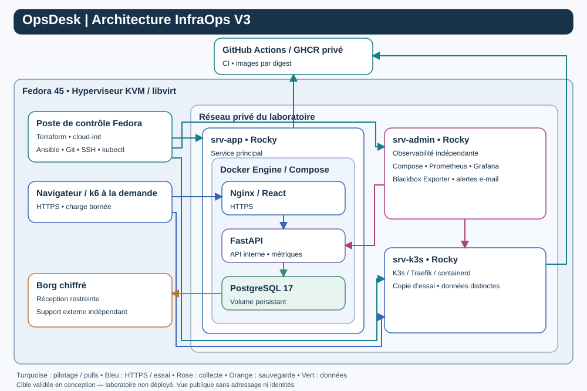

# Architecture d'OpsDesk — produit et historique

**Architecture d'infrastructure V3 validée en conception :** consulter en priorité le [registre des sept ADR](adr/README.md), les [principes des flux V3](architecture-v3-flux.md) et le [plan phases 0 à 10](architecture-v3-deploiement.md). Les décisions de déploiement plus anciennes conservées dans ce document sont **historiques et remplacées** lorsqu'elles contredisent ces ADR (par exemple Terraform dans `srv-admin`, HTTP :8080 pour la cible serveur, sauvegardes dans `~/sauvegardes`). La [vue globale](diagrams/README.md) décrit la cible V3. Les autres schémas du produit sont conservés ; voir [STATUS](../STATUS.md).

OpsDesk est une application web en trois parties : une interface, une API et une base de données, chacune dans son conteneur. L'application (version 2) est construite et testée ; l'infrastructure qui doit la faire tourner sur trois machines Rocky Linux est décidée mais pas encore construite. Ce document explique le fonctionnement, puis justifie chaque choix, du plus visible au plus détaillé. L'état de chaque élément est tenu dans [STATUS.md](../STATUS.md) ; les détails d'exploitation sont dans la [référence technique](reference-technique.md).

## Vue d'ensemble

**Publication :** seule la vue globale est publique. Les paramètres détaillés du laboratoire sont réservés à une page personnelle privée, hors GitHub.

Le navigateur ne parle qu'au **frontend**. Dans le **laboratoire local**, l'entrée est `127.0.0.1:8080`; dans l'**Architecture V3 serveur**, elle devient HTTPS :443, tandis que :8000 et :5432 restent internes. Nginx sert React et relaie les appels à FastAPI, qui seule accède à PostgreSQL. Les cadres continus décrivent la cible d'infrastructure validée ; les contrôles applicatifs actuels ont été exécutés sur des runners de CI, pas sur Rocky.

## Le trajet d'une requête

Suivre une action de bout en bout aide à comprendre qui fait quoi. Quand un agent du support prend un ticket en charge :

1. **Le navigateur** envoie `POST /api/tickets/6/status` au frontend, avec le jeton de session de l'agent.
2. **nginx** (frontend) reconnaît le préfixe `/api` et relaie la requête à l'API. Il retrouve l'adresse de l'API par son nom sur le réseau, à chaque requête.
3. **L'API** vérifie le jeton et le rôle (seul le support peut prendre un ticket en charge), puis vérifie que la transition est permise (`open` → `in_progress`).
4. **L'API** verrouille la ligne du ticket dans **PostgreSQL**, change son statut, l'assigne à l'agent s'il n'avait pas de responsable, et enregistre deux événements dans l'historique. Tout est validé en une seule transaction.
5. **La réponse** remonte jusqu'au navigateur, qui met à jour la page.

Si la base ne répond pas, l'API renvoie une erreur 503 explicite, et sa sonde `/health/ready` passe en échec : un orchestrateur ou une supervision peut le détecter.

## Les décisions de l'application

<b>Trois parties séparées, chacune dans son conteneur</b>

- **Problème** : une application de démonstration doit se comporter comme un vrai service, pour que son exploitation ait du sens.
- **Choix** : une interface (React servie par nginx), une API (FastAPI) et une base (PostgreSQL), dans trois conteneurs.
- **Pourquoi** : chaque partie se construit, se met à jour, se surveille et redémarre indépendamment ; c'est l'organisation la plus courante en entreprise, donc la plus utile à apprendre.
- **Alternatives écartées** : un seul conteneur, plus simple mais qui mélange les responsabilités ; des microservices, sans besoin réel à cette taille.
- **Compromis** : trois éléments à configurer, un réseau entre eux.
- **Vérifier** : `docker compose ps` affiche trois services `healthy`, et `scripts/smoke.py` réussit.

<b>FastAPI et SQLAlchemy pour l'API</b>

- **Problème** : une API qui valide ses entrées, gère des rôles et documente son contrat.
- **Choix** : FastAPI (Python 3.13), SQLAlchemy 2, psycopg 3.
- **Pourquoi** : validation automatique des données, documentation OpenAPI générée (`/api/docs`), code court et lisible ; SQLAlchemy permet de tester sur SQLite comme sur PostgreSQL.
- **Compromis** : un seul processus par conteneur ; on augmente la capacité en ajoutant des instances, pas des processus.
- **Quand choisir autrement** : fortes contraintes de performance, ou équipe déjà experte d'un autre écosystème.
- **Vérifier** : 28 tests (`backend/tests/`), joués sur PostgreSQL 17.

<b>nginx devant l'interface, avec résolution dynamique de l'API</b>

- **Problème** : servir l'interface et donner au navigateur une seule adresse, sans exposer l'API.
- **Choix** : nginx non-root sert les fichiers React et relaie `/api`, `/health` et `/version` ; il bloque `/metrics`.
- **Comment ça fonctionne** : nginx résout le nom de l'API à chaque requête (directive `resolver`, cache de 10 secondes) au lieu de le résoudre une fois au démarrage.
- **Pourquoi ce détail compte** : quand Docker recrée le conteneur de l'API, comme quand Kubernetes relance son pod, l'API peut revenir avec une nouvelle adresse IP. Avec une résolution unique, nginx garderait l'ancienne adresse et répondrait en erreur 502 ; il refuserait même de démarrer si l'API n'existait pas encore.
- **Vérifier** : l'essai du 18 novembre 2026 (API recréée avec une nouvelle adresse, frontend démarré sans API) est consigné dans [STATUS.md](../STATUS.md).

<b>Authentification par jeton et trois rôles</b>

- **Problème** : distinguer ce que peut faire un collaborateur, un agent du support et un administrateur.
- **Choix** : connexion par e-mail et mot de passe, jeton JWT signé, trois rôles vérifiés par l'API à chaque requête.
- **Pourquoi** : l'API ne garde aucune session en mémoire, donc plusieurs instances peuvent tourner côte à côte ; c'est le modèle attendu sur une infrastructure conteneurisée.
- **Limites** : pas de renouvellement automatique du jeton, pas d'authentification à deux facteurs ; les données restent fictives et le service ne doit pas être exposé sur Internet.
- **Remplace** la décision v1 « usage local sans authentification » (voir le registre ci-dessous).

<b>Observabilité intégrée dès l'application</b>

- **Problème** : pouvoir dire si le service fonctionne, et pourquoi il ne fonctionne pas.
- **Choix** : deux sondes (`/health/live` : le processus répond ; `/health/ready` : la base répond), des métriques Prometheus sur `/metrics`, des journaux JSON avec un identifiant par requête.
- **Pourquoi** : sans ces points d'accès, ni Docker, ni Kubernetes, ni Prometheus ne peuvent juger de l'état du service.
- **Limites** : aucune supervision n'est encore branchée ; les alertes restent à construire (phase 5).

## L'infrastructure cible (présentation publique)

Les décisions de l'Architecture V3 prévoient un hôte de virtualisation Linux, un poste de contrôle Terraform/Ansible sur Fedora, une VM applicative sous Compose, une VM d’observabilité indépendante et une VM Kubernetes réservée aux essais. L'ensemble doit être construit progressivement par infrastructure as code et Ansible.

La **vue globale** montre ces responsabilités. Les paramètres d'adressage, ports, comptes, droits et procédures d'exploitation sont conservés dans le dossier technique personnel.

Le laboratoire existant sert aussi aux exercices : srv-admin pour les bases Linux/SSH avant son provisionnement définitif, srv-k3s pour les essais et la reconstruction contrôlée. Pas de quatrième VM prévue ; la restauration de données s’effectue dans une base distincte.

Les étapes publiques se lisent ainsi : provisionnement reproductible, configuration des machines, livraison traçable, sauvegardes externes, copie d'essai isolée et qualification par des preuves. Voir le [plan de réalisation](architecture-v3-deploiement.md).

## Docker Compose et K3s

L'application tourne deux fois, sur deux serveurs indépendants.

- **Sur `srv-app`, avec Docker Engine et Compose (phase 4) :** c'est le service réel. Un fichier Compose décrit les trois conteneurs, leurs réseaux, le volume de la base et leurs sondes. systemd démarre le service `docker` au boot ; la politique de redémarrage `unless-stopped` relance ensuite les conteneurs, y compris après un arrêt imprévu. La sauvegarde et la restauration portent sur cette base.
- **Sur `srv-k3s`, avec K3s (phase 7) :** K3s tire les mêmes images sur GHCR et en fait tourner une copie d'essai, avec sa propre base de test (données fictives, distinctes ; sauvegarde ponctuelle et restauration vérifiée avant un exercice de reconstruction). On y apprend ce qu'un orchestrateur ajoute : sondes, redémarrage, retrait du trafic, mise à jour progressive.

Les deux ne se voient pas. K3s garde son propre moteur, containerd, et ne pilote que ce qu'il lance lui-même : Docker n'y joue aucun rôle. Prometheus sur `srv-admin` collecte les métriques autorisées ; Blackbox Exporter vérifie les points d’entrée HTTPS. Les images sont les mêmes (format OCI), donc ce qui s'apprend avec Compose (ports, volumes, variables, secrets, sondes) se retrouve dans K3s, sous d'autres noms.

| Couche | Sur `srv-app` | Sur `srv-k3s` |
| --- | --- | --- |
| Ce qui décrit le service | `compose.yaml` | Manifestes Kubernetes (Deployment, Service, Ingress) |
| Ce qui applique la description | `docker compose` (client) et le démon `dockerd` | Le plan de contrôle de K3s |
| Ce qui fait tourner les conteneurs | containerd et runc, pilotés par `dockerd` | containerd et runc, pilotés par le kubelet |
| Ce qui relance après un arrêt | La politique de redémarrage de Docker | Le kubelet et le Deployment |

**Pourquoi K3s, alors ?** Une seule application sur un seul serveur n'en a pas besoin : Compose suffit. K3s est là pour pratiquer Kubernetes. Avec un seul nœud, il n'apporte pas de haute disponibilité, mais srv-admin peut détecter sa panne. Les VM dépendent du même hôte.

## Conditions de réexamen

Ces conditions ne sont pas des exigences supplémentaires pour le laboratoire : elles aident à défendre une décision et à reconnaître ses limites. Réexaminer Compose si un besoin de disponibilité, de placement sur plusieurs nœuds ou de gestion de flotte est démontré ; le K3s mono-nœud actuel ne résout pas à lui seul ces problèmes. Vérifier l’indépendance du support externe Borg et la restauration après perte du poste ; une copie sur le même disque ne suffit pas. Réexaminer le dimensionnement après mesures de charge, et l'état Terraform distant si plusieurs opérateurs doivent travailler ensemble. Dans chaque cas, comparer le risque, le bénéfice, le coût et une méthode de validation avant de modifier la cible. Aucun changement de stack n'est présumé.

## Repères pour lire le registre

Lire d'abord les décisions qui déterminent **où vivent le service et les données, qui prépare les machines, comment une version est livrée et comment revenir en arrière**. Ce tableau est un index, pas une deuxième source de vérité.

| Question | Décision actuelle | Contrôle à prévoir |
| --- | --- | --- |
| Qui prépare l'environnement ? | Fedora et trois VM Rocky ; Terraform et Ansible pilotent les trois VM depuis Fedora | Inventaire libvirt, SSH, contrôle des frontières |
| Comment tourne le service ? | Docker Engine/Compose sur `srv-app`, K3s uniquement sur la copie d'essai | Sondes, exposition des ports, parcours de ticket |
| Comment limiter les privilèges ? | Administration Docker par `sudo`, SELinux et firewalld conservés | Droits, contextes et accès depuis sources autorisées/interdites |
| Comment protéger les données ? | Volume, sauvegarde PostgreSQL hors VM, restauration isolée | Ticket témoin restauré, perte et délai mesurés |

Pour chaque choix, chercher ensuite son **alternative, son coût, sa limite et sa condition de réexamen**. Les anciennes décisions restent conservées pour expliquer l'évolution du projet ; elles ne représentent plus la cible active.

## Décisions retenues

« Retenu » désigne une décision d'architecture, pas la preuve de sa mise en œuvre. L'application et les tests du socle sont documentés publiquement, tandis que les paramètres d'infrastructure et les procédures précises sont conservés dans le dossier technique personnel.

| Décision | Motif | Statut |
| --- | --- | --- |
| Application de tickets comme support InfraOps | Séparer développement applicatif et travail d'automatisation d'infrastructure | Socle qualifié sur runner |
| Trois services applicatifs | Isoler frontend, API et PostgreSQL | Vérifié sur la pile locale |
| Fedora, KVM/libvirt et trois VM Rocky | Construire un laboratoire reproductible | Validé en conception |
| Terraform et Ansible sur Fedora, cloud-init minimal | Séparer provisioning et configuration | À réaliser |
| Docker Engine et Compose pour le service principal | Déploiement simple et largement reproductible | À qualifier sur serveur |
| K3s pour une copie d’essai ; observabilité indépendante sur srv-admin | Isoler la charge de test et apprendre Kubernetes | À réaliser |
| HTTPS, secrets protégés, images immuables | Définir la sécurité dès le départ | À qualifier |
| Sauvegardes hors VM et restauration mesurée | Prévoir une reprise contrôlée | À réaliser |

Les décisions historiques détaillées ont été conservées hors du dépôt public ; les [sept ADR](adr/README.md) résument la cible actuelle et ses compromis. Cette synthèse évite de présenter comme valides des ports et procédures anciennes remplacées par l'Architecture V3.

## Historique : la version 1 et l'essai Ubuntu/WSL

La version 1 d'OpsDesk était une application Flask avec rendu HTML côté serveur, servie par Gunicorn, sans authentification, en deux conteneurs (`app` et `db`). Elle a été testée le 3 novembre 2026 lors d'un essai sur Ubuntu/WSL2 avec Docker Compose (port `127.0.0.1:18081`). Ses tests, ses preuves, son scan de sécurité et ses schémas sont conservés dans [`legacy/`](../legacy/) ; ils ne s'appliquent pas à la v2.

## Références

[FastAPI](https://fastapi.tiangolo.com/) · [PostgreSQL 17](https://www.postgresql.org/docs/17/) · [Docker Engine sur RHEL](https://docs.docker.com/engine/install/rhel/) · [Docker Compose](https://docs.docker.com/compose/) · [Docker et les pare-feu](https://docs.docker.com/engine/network/packet-filtering-firewalls/) · [Directive `resolver` de nginx](https://nginx.org/en/docs/http/ngx_http_core_module.html#resolver)
