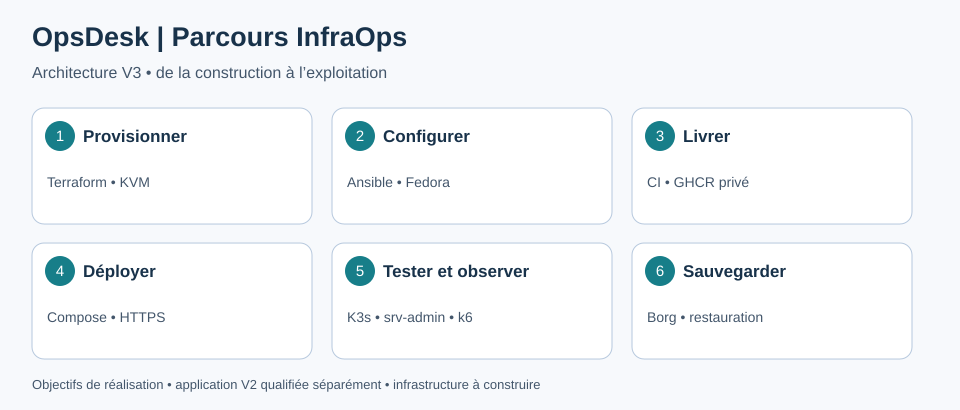

# OpsDesk — Présentation du projet InfraOps (Architecture V3)

> **Cible validée en conception, non encore déployée dans le laboratoire Fedora/Rocky.** Cette présentation décrit l'enchaînement attendu des travaux ; [STATUS.md](../STATUS.md) reste la source de vérité pour les réalisations, tests et preuves déjà obtenus.

[Consulter également la vue globale d'architecture](diagrams/architecture-globale-v3.svg) · [Ouvrir le visuel de présentation seul](images/opsdesk-presentation-v3.svg)

## Vue d'ensemble

OpsDesk utilise une application de gestion de tickets IT **fournie** (React/nginx, FastAPI et PostgreSQL) comme support d'un projet d'ingénierie **InfraOps** : préparer l'environnement Linux, automatiser l'infrastructure, déployer des versions, observer le fonctionnement et organiser la reprise.

La présentation est structurée en **deux phases complémentaires et six étapes**. Elle n'est pas la numérotation du [plan de déploiement, phases 0 à 10](architecture-v3-deploiement.md) : ce dernier précise les jalons et les conditions de réception.

## Phase A — Construction, provisionnement et déploiement automatisé

| Étape | Résultat recherché | Outils et responsabilités |
| --- | --- | --- |
| **1. Provisionner l'infrastructure** | Créer un laboratoire reproductible avec un hôte Fedora, un réseau privé de virtualisation et trois VM Rocky Linux aux rôles distincts | Terraform sur l'hôte ; KVM/libvirt |
| **2. Piloter et déployer** | Préparer les machines, appliquer le durcissement et livrer la configuration de façon traçable | Ansible et Git sur Fedora, cloud-init minimal, inventaire issu de Terraform |
| **3. Livrer les images** | Construire, analyser, versionner et distribuer des images d'application reproductibles | GitHub Actions, registre GHCR privé et références d'images immuables |

## Phase B — Exploitation, validation, supervision et sauvegardes

| Étape | Résultat recherché | Outils et responsabilités |
| --- | --- | --- |
| **4. Exécuter l'application** | Héberger les composants applicatifs séparés, isoler leurs échanges et conserver les données durablement | Docker Engine, Compose, nginx, FastAPI, PostgreSQL |
| **5. Tester et superviser** | Exécuter une copie d'essai indépendante du service principal ; collecter des métriques et tester les alertes et la charge sans impacter le service | K3s pour l’essai ; Prometheus, Grafana et Blackbox Exporter sur srv-ops ; k6 à la demande depuis Fedora |
| **6. Sauvegarder hors des VM** | Protéger les données applicatives, conserver des copies indépendantes et démontrer une restauration contrôlée | Export PostgreSQL, transfert restreint, stockage externe et Borg |

Le parcours d’apprentissage repose exclusivement sur Fedora et les trois VM de l’architecture : aucun serveur d’exercice ou de charge supplémentaire.

## Principes transversaux

- **Cloisonnement :** laboratoire privé, responsabilités distinctes, services internes non exposés directement aux utilisateurs.
- **Accès au service :** point d'entrée utilisateur protégé en HTTPS dans l'architecture cible.
- **Secrets et privilèges :** gestion chiffrée, comptes dédiés, moindres droits, SELinux et pare-feu.
- **Images et mises à jour :** livraison traçable, registre privé et connexions sortantes contrôlées.
- **Preuves :** tests fonctionnels, sécurité, restauration, supervision et performance, avec vérification progressive sur le véritable laboratoire.

## Limites de la présentation

Les six étapes sont **des objectifs de mise en œuvre**, et non six fonctionnalités déjà réalisées ou certifiées. Le socle applicatif fourni a ses propres validations sur runner ; les déploiements Fedora/Rocky et leur qualification personnelle restent à documenter séparément.

La table d'adressage complète, la matrice détaillée des flux, les clés, les comptes et les procédures d'exploitation personnelles restent exclusivement dans Notion.

**Pour aller plus loin :** [Architecture V3 et ADR](adr/README.md) · [Vue globale publique](diagrams/architecture-globale-v3.svg) · [Principes des flux](architecture-v3-flux.md) · [Phases 0 à 10](architecture-v3-deploiement.md) · [État réel](../STATUS.md).
